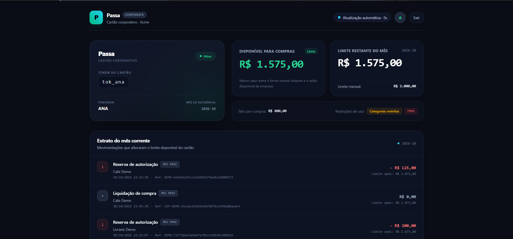
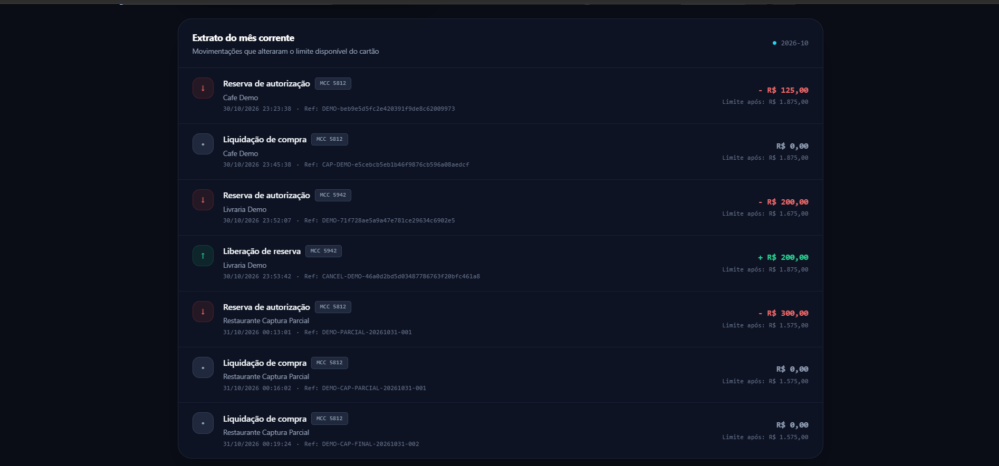
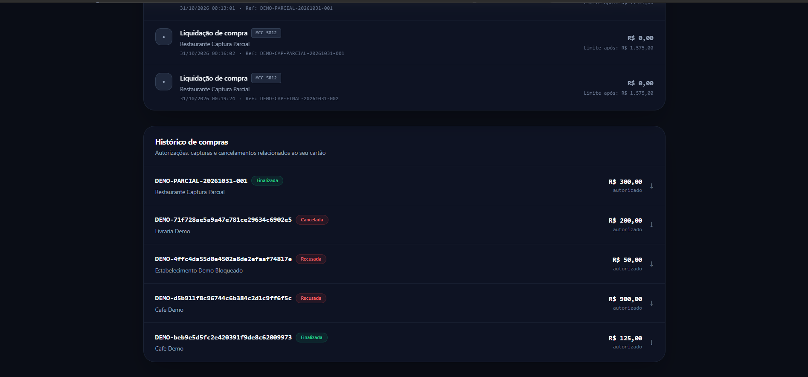
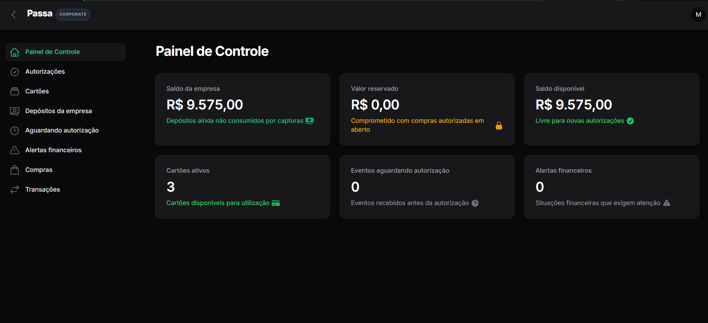
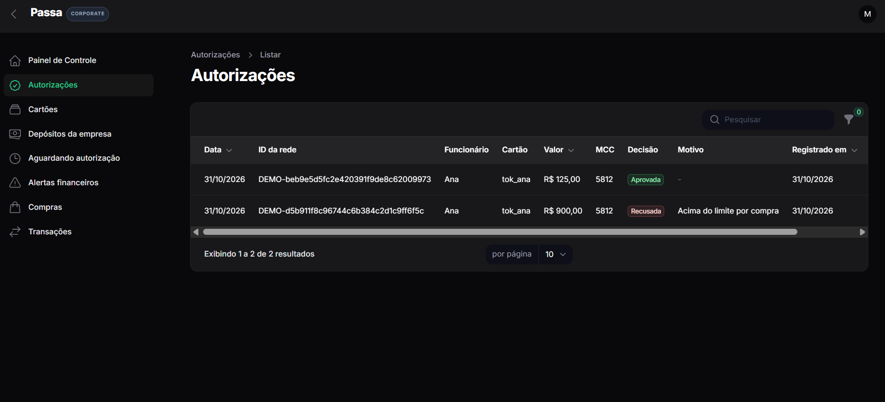
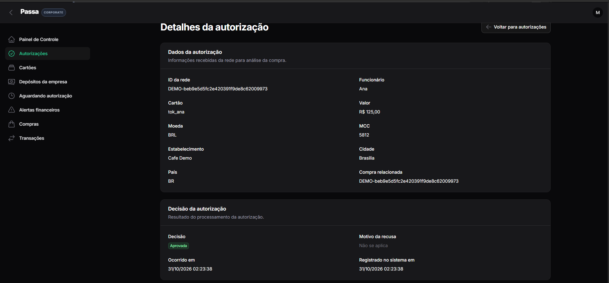
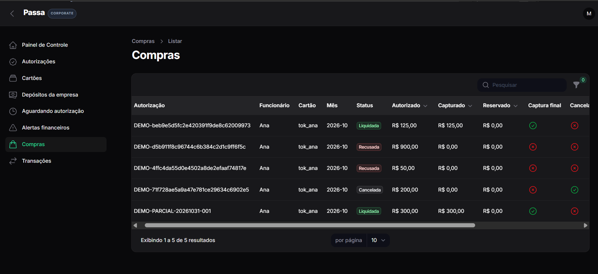
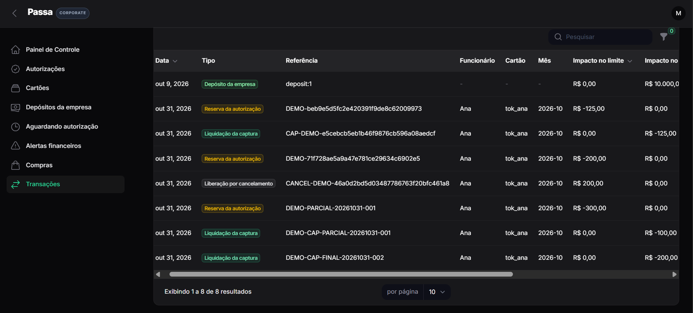
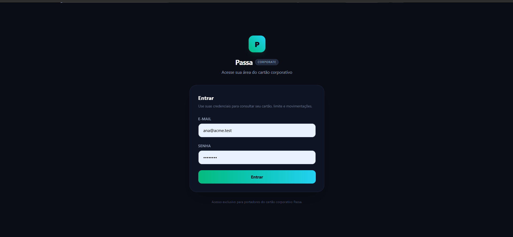
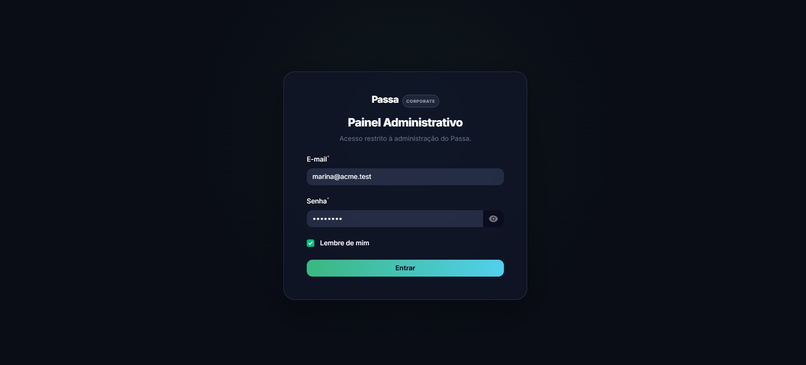

# Passa

**Plataforma de autorização e controle financeiro para cartões corporativos pré-pagos.**

Aplicação full stack construída com **PHP 8.4, Laravel 13 e PostgreSQL** para processar autorizações, capturas e cancelamentos de compras, com controle de saldo empresarial, limites por cartão e registro auditável de movimentações.

O núcleo financeiro contempla **idempotência, controle de concorrência, reconciliação de eventos recebidos fora de ordem e rastreabilidade**. A aplicação também oferece um painel administrativo e uma área exclusiva para funcionários.

**Tecnologias:** PHP 8.4 · Laravel 13 · PostgreSQL · Filament 5 · Livewire · Blade · Tailwind CSS · Pest.

> Projeto demonstrativo com empresa, usuários e transações fictícios. As imagens representam o sistema executado localmente.

## Visão geral do produto

### Área do funcionário

O portador acessa seu próprio cartão corporativo, consulta o valor disponível para compras, o limite mensal restante, as restrições de uso, o extrato e o histórico de compras. Os dados são atualizados periodicamente sem recarregar a página inteira.



<details>
<summary>Ver extrato e histórico de compras do funcionário</summary>

**Extrato mensal** — reservas, liberações e liquidações.



**Histórico de compras** — compras finalizadas, recusadas e canceladas.



</details>

### Painel administrativo

O painel oferece indicadores financeiros e operacionais, consultas de autorizações, compras, cartões e transações, além de acompanhamento de alertas e eventos pendentes. O registro de depósitos empresariais é a operação financeira de escrita disponível ao administrador.



<details>
<summary>Ver autorizações, compras e movimentações financeiras</summary>

**Autorizações** — decisões aprovadas e recusadas.



**Detalhes de uma autorização** — dados recebidos da rede e decisão de processamento.



**Compras** — estados de liquidação, recusa e cancelamento.



**Transações** — trilha de depósitos, reservas, liberações e capturas.



</details>

### Acesso por perfil

O sistema mantém fluxos de autenticação distintos para funcionários e administradores.

<details>
<summary>Ver telas de acesso</summary>

**Funcionário**



**Administrador**



</details>

## Arquitetura e decisões técnicas

- **API da rede:** recebe autorizações, capturas e cancelamentos e disponibiliza consultas de saldo e extrato.
- **Autenticidade das requisições:** verificação HMAC-SHA256 nos endpoints da rede.
- **Serviços de domínio:** concentram as regras de autorização, captura, cancelamento e depósitos.
- **Consistência financeira:** operações transacionais no PostgreSQL, com bloqueios de linha quando necessário.
- **Idempotência:** evita reaplicação financeira de eventos repetidos.
- **Eventos fora de ordem:** eventos recebidos antes da autorização podem ser persistidos e conciliados posteriormente.
- **Rastreabilidade:** projeções de saldo para decisões rápidas e histórico de transações para auditoria e extratos.
- **Interfaces:** Filament para administração e área do funcionário com Laravel, Blade e Livewire.

Os detalhes do modelo financeiro, as garantias, as limitações e as alternativas consideradas estão documentados em [`MODEL.md`](MODEL.md).

---

## Requisitos

Para executar o projeto localmente:

- PHP 8.4
- Composer
- Node.js / npm
- Docker
- Docker Compose

## Instalação

Suba os serviços de infraestrutura:

```bash
make env-up
```

Instale e configure o projeto:

```bash
composer setup
```

Caso prefira executar as etapas manualmente:

```bash
composer install
cp .env.example .env
php artisan key:generate
php artisan migrate:fresh --seed
npm install
npm run build
```

## Executando a aplicação

Para iniciar a aplicação com servidor Laravel, filas, logs e Vite:

```bash
composer dev
```

A aplicação ficará disponível em:

```text
http://127.0.0.1:8000
```

## Painel administrativo

O painel financeiro utiliza Filament e está disponível em:

```text
http://127.0.0.1:8000/admin
```

Usuária autorizada:

```text
E-mail: marina@acme.test
Senha: password
```

Somente Marina possui acesso ao painel.

O painel permite consultar cartões, compras, transactions, autorizações, issues e eventos pendentes.

A única operação financeira de escrita disponível no painel é o registro de depósito para a empresa.

## Área do funcionário

A área dos portadores fica fora do Filament.

Login:

```text
http://127.0.0.1:8000/login
```

Cartão do funcionário:

```text
http://127.0.0.1:8000/my-card
```

Usuários disponíveis no seed:

```text
ana@acme.test
bruno@acme.test
carla@acme.test
diego@acme.test
```

Senha para todos:

```text
password
```

A tela `/my-card` exibe o cartão do usuário autenticado, disponível atual, limite mensal restante, statement do mês e histórico das compras.

Os dados dinâmicos são atualizados através de polling do Livewire a cada 5 segundos, sem recarregar a página inteira.

Um funcionário nunca escolhe o cartão que deseja visualizar. O cartão é obtido diretamente a partir do usuário autenticado.

Usuários sem cartão recebem `403`.

## API da rede

Os endpoints da rede ficam sob:

```text
/api/network
```

Principais endpoints:

```text
POST /api/network/authorizations
POST /api/network/events
GET  /api/network/cards/{card_token}/available
GET  /api/network/cards/{card_token}/statement
```

Todos os endpoints da rede utilizam autenticação HMAC.

A assinatura utiliza:

```text
<timestamp>.<raw_body>
```

com HMAC-SHA256 e a chave:

```text
NETWORK_SECRET
```

Headers esperados:

```text
X-Network-Timestamp
X-Network-Signature
```

## Banco de dados e seed

O projeto utiliza PostgreSQL.

Para recriar completamente o banco com os dados necessários:

```bash
php artisan migrate:fresh --seed
```

O seed cria a empresa Acme, o depósito inicial de R$ 10.000,00, Marina e quatro portadores utilizados nos cenários.

## Testes

Para executar todos os testes:

```bash
php artisan test
```

ou:

```bash
make test
```

A suíte cobre, entre outros pontos:

- autenticação HMAC;
- decisão de authorization;
- ordem dos motivos de recusa;
- idempotência;
- capture e cancellation;
- eventos recebidos antes da authorization;
- capture após cancellation;
- capture de authorization recusada;
- overcapture;
- saldo e reserva da empresa;
- limite mensal dos cartões;
- `/available`;
- statement e seu invariante;
- cenários publicados P1, P2 e P3;
- acesso ao painel;
- depósito administrativo;
- login e isolamento da área do funcionário.

## Qualidade

Para executar todas as verificações de qualidade:

```bash
make check
```

O comando executa as ferramentas configuradas no projeto, incluindo Pint, Larastan e Rector.

## Modelo financeiro

A solução mantém duas representações complementares do estado financeiro.

As projeções atuais permitem decisões rápidas de autorização:

```text
Company.balance_cents
Company.reserved_cents
CardMonthBalance.limit_remaining_cents
Purchase.reserved_amount_cents
```

As `transactions` preservam cada movimentação financeira e são utilizadas para construção dos statements.

Os valores monetários são sempre armazenados em centavos inteiros.

As decisões completas sobre reserva, captura, cancelamento, eventos fora de ordem, overcapture, mês da compra, IDs e idempotência estão documentadas em [`MODEL.md`](MODEL.md).

## Concorrência

As alterações financeiras são realizadas dentro de transações do banco de dados.

Onde o estado precisa ser protegido durante uma decisão financeira, são utilizados bloqueios com:

```php
lockForUpdate()
```

O objetivo é impedir perda de atualização e inconsistência entre limite do cartão, saldo e reserva da empresa quando mensagens são processadas simultaneamente.

## Suposições

A implementação de demonstração utiliza a empresa fictícia Acme.

O identificador externo recebido da rede é preservado separadamente do ID interno do banco.

O mês da compra é definido pelo `occurred_at` da authorization convertido para `America/Sao_Paulo`.

Eventos podem chegar antes da authorization e são persistidos para reconciliação posterior.

Capturas válidas não são rejeitadas por ultrapassar o valor esperado. O movimento financeiro é processado e, quando aplicável, um issue é criado.

Uma cancellation sem reserva aberta é armazenada como fato, mas não cria transaction financeira.

Mais detalhes e alternativas descartadas estão em [`MODEL.md`](MODEL.md).

## Documentação adicional

[`MODEL.md`](MODEL.md) contém as decisões de domínio, riscos, garantias, cenários P2/P3 e alternativas descartadas.

[`DEVELOPMENT.md`](DEVELOPMENT.md) contém anotações sobre o processo de implementação e os principais ajustes realizados durante o desenvolvimento.
